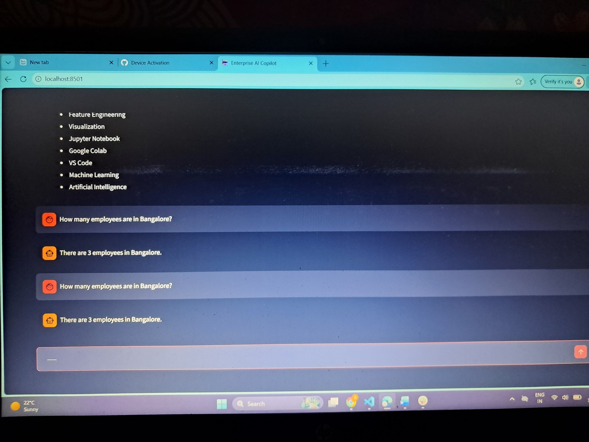
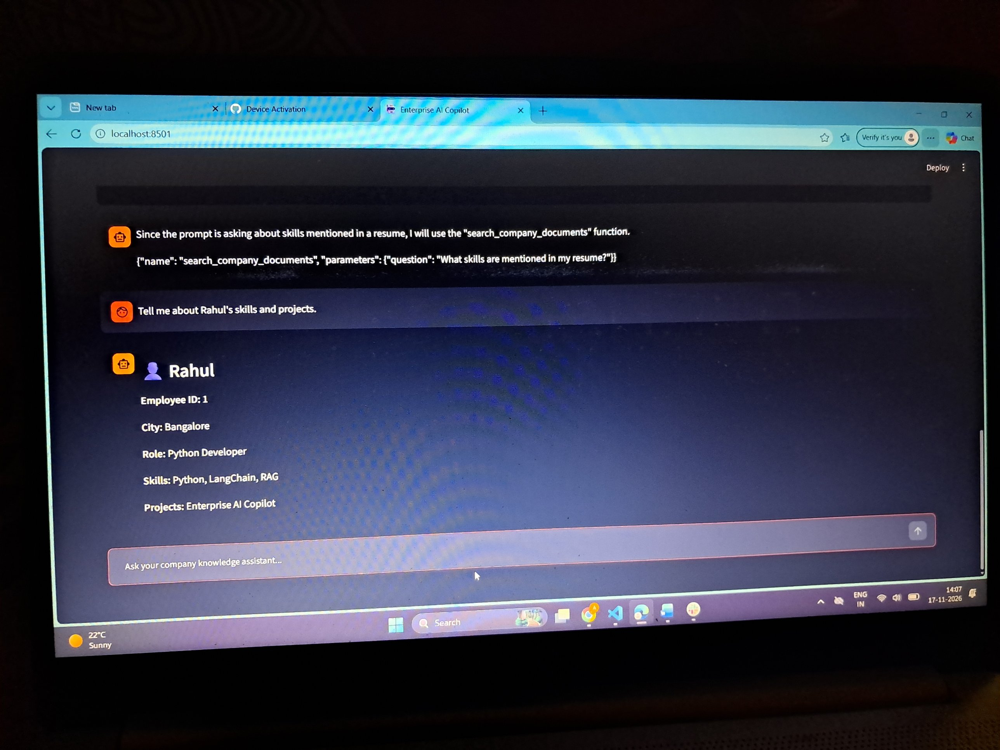
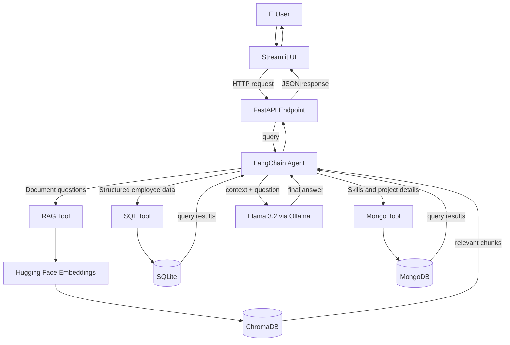

# 🤖 Enterprise AI Copilot: Intelligent Knowledge and Data Assistant

An AI-powered assistant that answers questions about company documents and structured enterprise data in plain English. A LangChain agent decides which source to use (documents, SQL, or MongoDB) and a local Llama 3.2 model writes the final answer.

> [!NOTE]
> The whole system runs locally: Llama 3.2 is served through Ollama, so no paid LLM API is needed.

---

## ✨ Features

- 💬 Chat-style interface built with **Streamlit**
- ⚡ **FastAPI** backend that exposes a clean REST endpoint
- 🧠 **LangChain agent** that picks the right tool for each question
- 📄 **RAG** over documents (resumes, project information) using Hugging Face embeddings and ChromaDB
- 🗄️ **SQLite** tool for structured employee data
- 🍃 **MongoDB** tool for employee skills and project details
- 🦙 **Llama 3.2** (via Ollama) for natural language answers
- 🧪 Unit tests with **PyTest**
- 🐳 **Docker** support

---

## 📸 Screenshots

Here is the application running locally, answering questions from each of the three data sources.

### 1. Home screen
The Streamlit chat interface where the user asks questions.


### 2. Document question (RAG + ChromaDB)
The agent searches the resume using Hugging Face embeddings and ChromaDB, then Llama 3.2 lists the skills.


### 3. Structured data question (SQLite)
The agent queries the SQLite employee table and returns a direct answer.



### 4. Skills and project question (MongoDB)
The agent fetches the employee profile (ID, city, role, skills, projects) from MongoDB.



---

## 🏗️ Architecture

> [!IMPORTANT]
> The agent is the brain of the system. It reads the user's question, chooses the right tool, and then uses Llama 3.2 to turn the tool result into a final answer.

### System diagram



### Request flow

1. The user asks a question in the **Streamlit UI**.
2. Streamlit sends the request to the **FastAPI** endpoint.
3. FastAPI forwards the query to the **LangChain agent**.
4. The agent chooses a tool based on the question:
   - **Documents** (for example resumes or project information): uses **RAG** with Hugging Face embeddings and **ChromaDB**.
   - **Structured employee data**: uses **SQLite**.
   - **Employee skills or project details**: uses **MongoDB**.
5. The tool results are returned to the agent.
6. The agent sends the results to **Llama 3.2** (via Ollama) to generate a natural language answer.
7. The agent returns the final answer to FastAPI.
8. FastAPI sends the response back to Streamlit in **JSON** format.
9. Streamlit displays the final answer to the user.

---

## 🧰 Tech Stack

| Category | Technology |
|---|---|
| Language | Python |
| LLM | Llama 3.2 (via Ollama) |
| Agent framework | LangChain |
| Embeddings | Hugging Face |
| Vector database | ChromaDB |
| Relational database | SQLite |
| NoSQL database | MongoDB |
| Backend | FastAPI |
| Frontend | Streamlit |
| Testing | PyTest |
| Containerization | Docker |
| Version control | Git |

---

## 📁 Project Structure

```text
.
├── Data/                  # Source documents and datasets
├── chroma_db/             # Persisted ChromaDB vector store
├── screenshots/           # App screenshots used in this README
├── src/
│   ├── agents/            # LangChain agent and tool routing
│   ├── database/          # SQL and MongoDB tools
│   │   ├── check_tool.py
│   │   ├── create_database.py
│   │   ├── mongo_tool.py
│   │   ├── sql_tool.py
│   │   ├── test_mongo_tool.py
│   │   └── test_sql_tool.py
│   ├── ingestion/         # Document loading and embedding
│   ├── llm/               # Llama 3.2 / Ollama setup
│   ├── rag/               # Retrieval logic with ChromaDB
│   ├── utils/             # Helper functions
│   ├── __init__.py
│   └── api.py             # FastAPI application
└── README.md
```

---

## 🚀 Getting Started

### Prerequisites

- Python 3.10 or higher
- [Ollama](https://ollama.com) installed
- MongoDB running locally (or a connection string)
- Docker (optional)

### Installation

```bash
# 1. Clone the repository
git clone <your-repo-url>
cd <your-repo-name>

# 2. Create and activate a virtual environment
python -m venv .venv
source .venv/bin/activate        # On Windows: .venv\Scripts\activate

# 3. Install dependencies
pip install -r requirements.txt

# 4. Download the Llama 3.2 model
ollama pull llama3.2
```

### Set up the data

```bash
# Create the SQLite database
python src/database/create_database.py
```

Then run your ingestion script from `src/ingestion/` to embed the documents into ChromaDB.

### Run the application

```bash
# Start the FastAPI backend
uvicorn src.api:app --reload

# In a new terminal, start the Streamlit UI
streamlit run <your-streamlit-file>.py
```

---

## 🧪 Running Tests

```bash
pytest
```

---

## 💡 Example Questions

| Question | Tool used |
|---|---|
| "What skills are mentioned in the resume?" | RAG (ChromaDB) |
| "How many employees are in Bangalore?" | SQLite |
| "Tell me about Rahul's skills and projects." | MongoDB |

---

## 🔮 Future Improvements

- Chat history and memory
- User authentication
- Support for more document types
- Cloud deployment

---

## 🤝 Contributing

Contributions are welcome. Fork the repository, create a branch, and open a pull request.

## 📄 License

This project is licensed under the MIT License.
